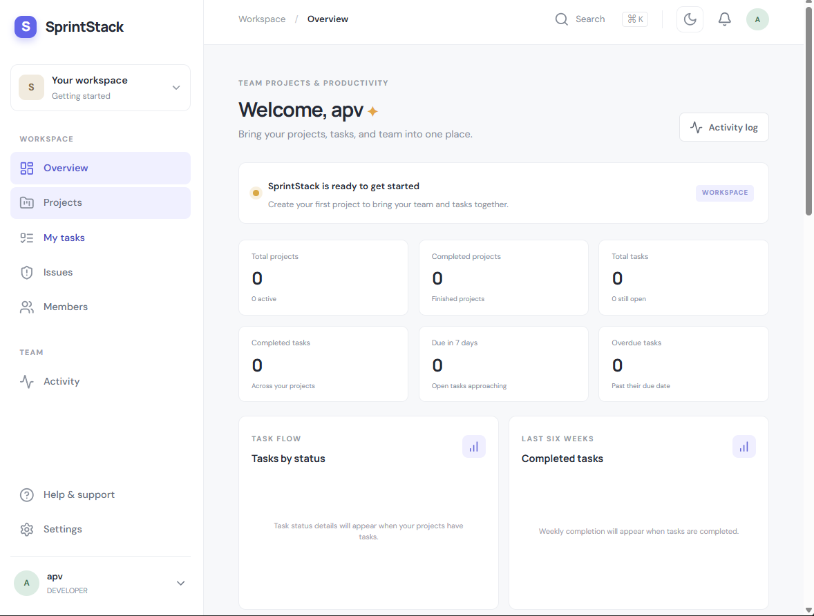

# SprintStack

SprintStack is a full-stack team productivity app for projects, memberships, tasks, issue tracking, comments, notifications, activity history, and database-backed delivery analytics. The display name is configured separately so it can be changed to KKH later without changing the repository identity.

## Application preview



The overview brings workspace activity, project and task metrics, and delivery analytics together in one place.

## Stack

- Frontend: React 18, JavaScript, Vite, Tailwind CSS, React Router, Axios, Lucide, Recharts
- Backend: Java 21, Spring Boot 3, Spring Security, Spring Data JPA, Bean Validation, Flyway, Maven
- Database: MySQL 8

No Docker, Kubernetes, Swagger/OpenAPI, microservices, Firebase, or TypeScript are used.

## Prerequisites

- Java 21
- Maven 3.9+
- Node.js 20+ and npm
- MySQL 8

## Local setup

1. Create a MySQL database named `sprintstack`.
2. From `backend/`, set the environment and start Spring Boot:

   ```powershell
   $env:DB_URL = 'jdbc:mysql://localhost:3306/sprintstack?useSSL=false&allowPublicKeyRetrieval=true&serverTimezone=UTC'
   $env:DB_USERNAME = 'root'
   $env:DB_PASSWORD = 'your-local-password'
   $env:JWT_SECRET = 'replace-with-a-random-secret-of-at-least-32-characters'
   mvn spring-boot:run
   ```

   Flyway creates the schema and Hibernate validates it. Set `FRONTEND_URL` if the Vite app uses a different origin (default `http://localhost:5173`).

3. In another terminal, from `frontend/`:

   ```powershell
   npm ci
   npm run dev
   ```

4. Open `http://localhost:5173`. The API health endpoint is `http://localhost:8080/api/health`.

Vite reads `VITE_API_URL` and `VITE_APP_NAME` at build time. Put local values in `frontend/.env.local`; the default display name is SprintStack. Spring reads `DB_URL`, `DB_USERNAME`, `DB_PASSWORD`, `SERVER_PORT`, `FRONTEND_URL`, `JWT_SECRET`, and `JWT_EXPIRATION_MS`. `.env.example` contains placeholders only; do not commit credentials.

## Implemented features

- Registration, login, BCrypt passwords, stateless JWT security, profile editing, password changes, client logout, and protected API routes.
- Project create, read, update, archive; per-project roles; existing-user search, membership changes, ownership transfer, member workload summaries, and a searchable member directory.
- Task CRUD, assignment, status and priority filtering, search, deadline/priority sorting, “mine” and overdue views, Kanban and bulk status updates, labels, effort, comments, and filtered CSV export.
- Issue reporting with assignment, severity/status/priority filtering, search, issue comments, project issue lists, and filtered CSV export.
- Project and workspace activity feeds, recent dashboard activity and notifications, database-backed notification links/read actions, and scheduled due-date/overdue reminders.
- Project owners can connect a GitHub repository; project teammates can view recent repository activity and commits from the project page.
- Persistent profile photos shared across the app and displayed on the user’s team pass, plus light/dark themes and animated workspace navigation.
- Keyboard task search (Ctrl/Cmd+K), in-app help, and CSV export for member listings.
- Dashboard metrics, task-state distribution, project completion, weekly completion, open assigned-task workload, and project-level task/issue/team analytics, all computed from database data.
- Flyway schema migrations, API validation/error handling, integration and unit tests, and GitHub Actions checks.

Email invitations are intentionally not faked. The application has been started against MySQL 8.4 locally; H2 MySQL-mode is also used for migration and persistence integration tests.

## API overview

All paths below are prefixed with `/api`.

| Area | Paths | Access |
| --- | --- | --- |
| Health | `GET /health` | Public |
| Authentication | `POST /auth/register`, `POST /auth/login`, `GET /auth/me`, `PATCH /auth/profile`, `PUT /auth/password` | Register/login public; others authenticated |
| Dashboard | `GET /dashboard` | Authenticated |
| Projects | `/projects` and `/projects/{id}` | Authenticated; membership and project-role checks |
| Project analytics | `GET /projects/{id}/analytics` | Authenticated project members |
| Members | `/projects/{id}/members` and nested search/role/owner routes | Authenticated; project-role checks |
| Tasks | `/projects/{id}/tasks`, `/projects/{id}/tasks/status`, `GET/PUT/DELETE /tasks/{id}`, `/tasks/{id}/status` | Authenticated; membership/assignment checks; bulk status changes accept at most 50 task IDs from one project |
| Issues | `/projects/{id}/issues`, `GET/PUT /issues/{id}`, `/issues/{id}/status` | Authenticated; membership checks; project issue queries support status, severity, priority, and text filters |
| Comments | `/tasks/{id}/comments`, `/issues/{id}/comments` | Authenticated; authors manage their own comments |
| Activity | `/activity`, `/projects/{id}/activity` | Authenticated workspace members; activity is limited to projects the caller can access |
| Notifications | `/notifications`, `/notifications/unread-count`, `/notifications/{id}/read`, `/notifications/read-all` | Authenticated owner |

## Verification

From `backend/`: `mvn test`

From `frontend/`: `npm ci` then `npm run build`

GitHub Actions runs these checks on pushes and pull requests to `main`.

For manual API checks, import [`postman/team-project-api.postman_collection.json`](postman/team-project-api.postman_collection.json) into Postman. Set the collection’s `email` and `password` variables locally, run Login or Register first, then run the project/task/issue requests in order. The token and created record IDs are saved as collection variables. Do not export or commit real credentials.

## Problem statement and objectives

Teams often split project plans, task assignments, bug reports, and progress updates across separate tools. This application brings those workflows into one project workspace with role-aware access and database-backed reporting. The goal is to make ownership, deadlines, and delivery progress visible without relying on demo data.

## Architecture

The codebase is a modular monolith. The React client sends authenticated HTTP requests to Spring MVC controllers. Controllers validate request DTOs and delegate authorization and business rules to service classes. Services read and write through Spring Data repositories, with MySQL as the source of truth. Flyway applies schema changes in order; JWT authentication protects API routes; scheduled jobs create deadline notifications.

```text
React + Vite
    │ HTTPS/JSON + bearer JWT
    ▼
Spring Security → Controllers → Services → JPA repositories
                                             │
                                             ▼
                                           MySQL
```

## Repository layout

```text
.
├── backend/
│   └── src/{main,test}/java/com/sprintstack/
│       ├── config/       # Security and application configuration
│       ├── controller/   # REST endpoints
│       ├── dto/          # Validated request and response types
│       ├── entity/       # JPA entities and enums
│       ├── exception/    # API error mapping
│       ├── repository/   # Database access
│       ├── security/     # JWT authentication
│       └── service/      # Business rules and analytics
├── frontend/src/
│   ├── components/       # Shared dialogs, charts, and notifications
│   ├── pages/            # Route-level screens
│   └── lib/              # API, branding, and CSV helpers
├── postman/              # Manual API request collection
└── .github/workflows/    # CI checks
```

## Data model

- A user can join many projects through `project_members`; that relationship stores the project-specific role and has a unique `(project_id, user_id)` constraint.
- Projects own tasks, issues, activity records, and memberships.
- Tasks may have an assignee, labels, and comments. Issues may have an assignee and comments.
- Notifications belong to a user and optionally reference a related record. Activity records retain the actor, project, action, and timestamp.
- Foreign keys protect references; indexes support membership, status, assignee, deadline, and notification queries. Flyway migrations are in `backend/src/main/resources/db/migration/`.

## Screenshots

The overview screenshot above shows the workspace dashboard in its empty-project state. Additional screenshots can be added as updated full-page captures become available.

## CI

GitHub Actions runs the backend test suite and frontend production build on pushes and pull requests to `main`. The workflow is defined in `.github/workflows/ci.yml` and uses Java 21 and Node.js 20.

## Future improvements

- Add email invitations after a delivery provider and sender configuration are selected.
- Add paginated activity and notification history for larger workspaces.
- Add deployment configuration after a hosting environment has been chosen.
